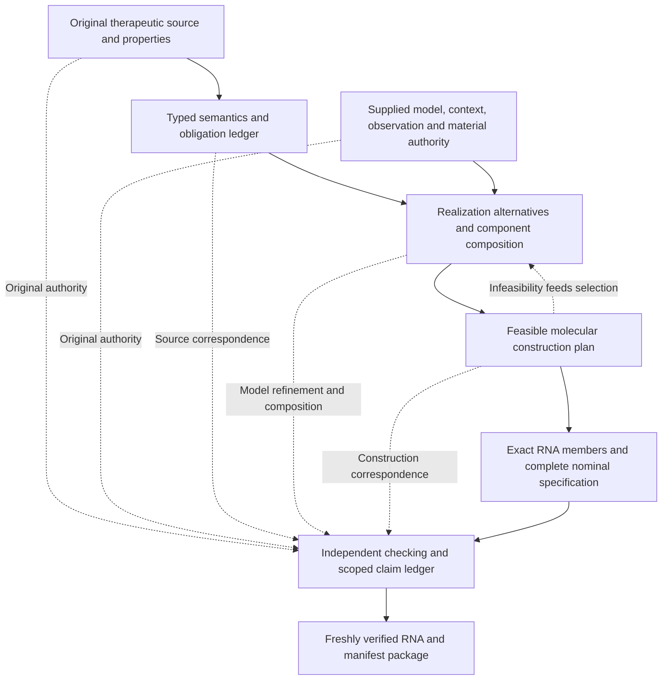

# Architecture refactoring roadmap

Status: **M1 implemented in the working branch with focused local validation;
direct native workflow probes passed; hosted/main acceptance pending, 2026-10-13**.
M0 established this audit, architecture constraints and review practice. M1 now
repairs the report/census contract under versioned assessment/checker/service
identities; the later refactors remain planned. The retained main/release and
local diagnostic baselines below remain historical evidence. They do not grant
acceptance to the changed working tree or close the separate M2 admission gap.

The objective remains high-level therapeutic programs compiled into exact,
complete RNA payload specifications for human immune cells engineered in vivo.
Compilation may establish conditional correctness under supplied executable
contracts without waiting for biological validation. The compiler must also make
clear which causal, material, deployment and observation relationships it has
actually checked. Merely retaining an assumption is a different capability from
executing its model or proving its compatibility with another assumption.

This roadmap implements the [architecture charter](architecture-charter.md),
AC-01 through AC-09. The [capability matrix](capability-matrix.md) records what
exists now; the [architecture review](architecture-review.md) guides changes to
those capabilities. Planned exits below do not expand that matrix by themselves.
The existing [development validation protocol](development-validation.md) remains
the authority for local feedback, hosted execution and release acceptance.

## Baselines and evidence boundaries

The inspected main baseline is
`ae683603dfbac95aeee1b1bc15efa3f873d0c630`. Its first-CAR path is an exact static
expression/material profile under supplied premises. Its broader source,
execution, architecture and material profiles have different supported subsets;
their individual successes cannot be combined into an unsupported end-to-end
claim. This roadmap does not transfer an earlier run's acceptance to future edits.

Two separately owned efforts informed the audit:

| Effort | Inspected source | Scope and integration boundary |
| --- | --- | --- |
| Controlled composition | `0e76e25d5f08cca4ca87fd8778d0f4a0dd441039`, `work/car-controlled-composition` | Joined artificial two-RNA material/behavior workflow and one hosted installed rehearsal are documented; complete real RNA inputs, conditional quantitative work and broader integration/release gates remain open. See that checkout's `docs/controlled-composition-progress.md`, milestone table and RC6 checkpoint. |
| E1 second CAR reference | `11b6b6da94497fea9afae8dfa12dd900c7295f9f`, `work/car-second-reference` | A second static reference uses shared authoring interfaces. It is a separate implementation checkpoint, not evidence that arbitrary dynamic programs or a new release are accepted. |

Preserve those checkouts and their owners' frozen revisions. Any future
integration must refresh their state, reconcile intentionally and retain their
own acceptance records. Pending-checkout citations in the audit register name
that checkout explicitly; they are not claims about merged main.

The audit classifications below distinguish a source/report defect from a
potential selection failure and from intentional, safely rejected limitations.
The original architecture audit did not execute native probes. The later local
baseline observations recorded below have their own exact source/binary/receipt
identities; they are diagnostic evidence, not M1/M2 implementation or hosted
acceptance. Other source-inspected failure hypotheses remain hypotheses until
their specified reproductions run against recorded revisions.

## Target architecture

The target is one extensible compiler/checker architecture with explicit
capabilities, not one unrestricted biological model. A closed initial profile can
remain useful while broader mechanisms are implemented through versioned
interfaces.

The layers need distinct responsibilities:

1. **Source and properties.** Desired behavior, safety/progress properties,
   environment assumptions and permitted observations remain distinct. A property
   monitor may own observation history without inserting that history into the
   therapeutic implementation. Python control flow remains authoring-time code.
2. **Executable realization.** A supplied mechanism states what the candidate
   does. It must not copy requested deadlines into its actual kinetics or use the
   expected answer as an implementation. Refinement witnesses connect observable
   behavior without requiring identical graph spelling.
3. **Causal context and observation.** Delivery, RNA availability, expression,
   localization, functional product availability and activity have explicit
   transition relations or explicitly unresolved interfaces. External controller
   exposure is separate from its administration history. Evidence missingness
   does not rewrite a physical state.
4. **Composition.** Modules own state, timers, resources, inputs and outputs.
   Assumption/guarantee checks establish compatibility in the declared context.
   Shared resources and feedback remain explicit; whole-program checking is a
   reference against which each initial composition rule is tested.
5. **Product and material realization.** Behavioral module, product, ORF, RNA
   member and recipient counts are independent. Authorized construction steps
   preserve exact bases, chemistry, coordinates and product identities. A supplied
   reference is one realization strategy, not the universal synthesis algorithm.
6. **Selection and checking.** Selection considers behavioral and material
   feasibility together. Proposal generation is untrusted. Validity of a selected
   candidate, census completeness, ranking correctness and empirical status are
   separate claims with separate evidence.
7. **Claims and dependencies.** Every source obligation has a justified
   disposition and an explicit dependency set. Full original authority remains
   necessary for publication. Dependency analysis supports explanation and fresh
   recomputation; it never makes a stale PASS valid for changed inputs.

## Preserve and redesign

| Preserve | Redesign or extend | Charter |
| --- | --- | --- |
| Immutable complete original requests, source identities and exact source paths | Common semantic contracts beneath closed profiles; explicit adapters instead of an expanding set of interacting Boolean route flags | AC-01, AC-08 |
| Separate producer and independent Verify roles; private accepted capabilities | Small, reviewable proof interfaces for new rewrites, plant abstractions and composition rules | AC-02, AC-06 |
| Complete obligation census and explicit unknown/unsupported outcomes | A claim algebra that cannot equate conditional, not-applicable and discharged obligations | AC-02, AC-05 |
| Exact source-to-implementation correspondence | Checked semantic refinement and property-only monitor state, rather than obligatory graph isomorphism | AC-01, AC-02 |
| Typed recipients, compartments, helper accounting and same-cell co-delivery | Executable causal deployment/expression envelopes and quantitative compatibility | AC-03, AC-05 |
| Independent source requirements and actual mechanism parameters | Reusable mechanisms with explicit lifecycle causes and model nondeterminism where supported | AC-01, AC-05 |
| Complete RNA/chemistry identity, original roots and independent reconstruction | Product/ORF/member allocation and authorized sequence transformations constrained by source obligations | AC-04, AC-07 |
| Bounded search, cancellation, work/publication accounting and exact census | Joint realization search, branch rejection taxonomy and scalable independently checked witnesses | AC-04, AC-09 |
| Full artifact identity and provenance; chemistry distinct from sequence spelling | Separate semantic/material/context/observation dependencies for impact analysis | AC-07, AC-09 |
| Exact-revision hosted and installed acceptance | Incremental feature adoption with explicit versions, retained compatibility and a coherent final acceptance candidate | AC-06, AC-08 |

## Audit register

These entries are actionable design evidence, not a claim that every limitation
is a bug. Source line references describe the baseline above; paths and named
functions are the stable lookup keys if later edits move the lines.

| ID / classification | Evidence | Consequence and required probe | Milestone |
| --- | --- | --- | --- |
| AR-01 — **confirmed historical source/report defect; working-branch correction locally checked** | At the inspected main baseline, the [expression specification](https://github.com/logannye/biocompiler/blob/ae683603dfbac95aeee1b1bc15efa3f873d0c630/docs/car-expression-material-profile-design.md#L246) assigns `not_applicable` or `conditional` to three obligations; [native report construction](https://github.com/logannye/biocompiler/blob/ae683603dfbac95aeee1b1bc15efa3f873d0c630/core/lib/checker/policy_expression_material_check.ml#L76) instead groups `safety_and_progress_satisfaction`, `requested_assurance_not_established` and `expression_material_correspondence` as `discharged` when encoding/length pass. | M1 corrects these dispositions, original paths and evidence under v0.2 identities with independent literal regressions; hosted/main acceptance remains pending. The historical top-level scope remained conditional, empirical/human-use status unassessed, and admission rejected actual safety/progress demands: this is **not** evidence of a safety-requirement admission bypass. Preserve the original evidence rather than relabeling it. | M1 |
| AR-02 — **confirmed scoped limitation** | [Component route preparation](../src/biocompiler/policy/component_material.py), `prepare_request`, lines 24–45, admits particular flag combinations and rejects others. Static expression [admission](../core/lib/checker/policy_expression_source_admission.ml), lines 62–78 and 148–167, has a different closed subset. | Source vocabulary is not uniformly compilable across paths. Exercise one declared capability combination through authoring, native admission, realization, material, Verify and installed export; identify the exact unsupported boundary. | M2 |
| AR-03 — **confirmed scoped limitation** | [Implementation binding](../core/lib/checker/policy_implementation_binding_check.ml), lines 228–245 and 320–327, enforces exact operator structure and rejects requirement-only rising memory. [Requirement monitor](../core/lib/realization_checker/policy_requirement_monitor.ml), lines 128–131, resolves a rising event through an existing activation. | An observational property may require changing implementation topology before it can be checked. A semantically equivalent reordered/refactored expression may lack a correspondence witness. Test a property-only edge monitor and checked equivalent Boolean rewrites without adding therapeutic behavior. | M3 |
| AR-04 — **inference, not reproduced** | [Staged lowering](../core/lib/compiler/policy_staged_lowering.ml), lines 197–217, sorts matching models by identity and chooses the first; lines 540–542 retry layouts only on missing-model errors. [Material producer](../core/lib/producer_service/policy_component_material_producer.ml), lines 22–27, lowers before material assembly. | Hypothesis: adding an earlier-sorting semantically matching model without a feasible material realization masks a later feasible model. Construct the two-model counterexample and vary insertion order and neutral identities. Do not label this a confirmed false negative until reproduced; if upstream admission prevents the case, retain that result and narrow the proposed fix. | M6 |
| AR-05 — **confirmed scoped policy; generalized-search debt** | [Selection common-authority checker](../core/lib/realization_checker/policy_component_selection_common.ml), lines 227–267 and 330–337, permits a closed leader/geometry variation while retaining the semantic union. [Selection checker](../core/lib/realization_checker/policy_component_selection_check.ml), lines 152–153 and 185–192, withholds a winner if any child lacks acceptance. | This intentionally attests every child; it is not a general search that tolerates well-formed infeasible alternatives. Keep this operation's meaning. A distinct generalized selector must distinguish valid rejection, unsupported semantics, malformed authority and incomplete enumeration before ranking feasible candidates. | M6, M7 |
| AR-06 — **confirmed scoped limitation in pending controlled work** | At the controlled baseline, `core/lib/domain/policy_controlled_domain.ml`, lines 5–6 and 291–308, supplies separate Boolean RNA/protein factors. `core/lib/domain/policy_controlled_composition_request.ml`, lines 105–107, requires availability to come from that domain. `check_batch` at lines 246–254 does not implement an RNA-to-protein transition relation. | Even perfect supplied expression/persistence kinetics cannot be attached as a reusable causal module in this profile; the author must prepare compatible histories. Test a supplied arrival-to-expression delay and post-RNA protein persistence contract, with impossible trajectories rejected by the contract rather than silently pruned. | M4 |
| AR-07 — **confirmed scoped limitation** | Main [architecture verification](../src/biocompiler/verification/payload_architecture.py), lines 474–490, binds modeled components to the complete refinement model and rejects unmapped resource/domain declarations. Pending controlled `core/lib/realization_checker/policy_controlled_behavior_check.ml`, lines 197–210, explicitly reports local guarantees as identity projections of supplied functional availability. | Current whole-program checking does not supply reusable component-level assumption/guarantee composition. Add two individually valid modules with incompatible shared resources or contexts and require a specific composition rejection; compare supported compositions with whole-program reference checking. | M5 |
| AR-08 — **confirmed scoped limitation** | Main [expression producer](../core/lib/producer_service/policy_expression_material_producer.ml), lines 15–23, reconstructs supplied authority. Pending controlled `core/lib/checker/policy_controlled_composition_admission.ml`, lines 134–143, 181–194 and 222–234, restricts material to two direct complete roots, four regions each and ordinary CDS translation. | A shorter valid design from supplied alternate parts, a changed product allocation or a multi-product member requires caller-side reconstruction or a new profile. Test authorized alternatives that meet the same product requirement with different material; do not mistake a rejection-only source edit for sequence synthesis. | M6 |
| AR-09 — **confirmed scoped limitation in pending controlled work** | `core/lib/domain/policy_controlled_activity_implementation.ml`, lines 4, 11–14 and 31–63, fixes eight primitives and positive onset/cessation/reactivation delays, with one gate and one cessation delay. | Distinct controller-loss, antigen-loss and protein-loss kinetics cannot be represented by that one mechanism family. Test a supplied cause-specific finite lifecycle model; retain explicit unsupported status until implemented. | M4, M5 |
| AR-10 — **confirmed coarse dependency design; scaling impact to measure** | [Expression request identity](../core/lib/domain/policy_expression_material.ml), lines 98–116 and 168–173, binds complete project metadata. [Obligation evidence](../core/lib/checker/policy_expression_material_check.ml), lines 58–106, principally points to whole-source, whole-structure and contract pins. | A title edit and a CDS edit both invalidate the top-level artifact, correctly, but need different impact explanations. Measure repeated serialization and checking before changing granularity; preserve complete artifact identity while recording obligation-specific semantic dependencies. | M7 |
| AR-11 — **locally reproduced declared-subset admission defect** | The [expression contract](car-expression-material-profile-design.md#closed-source-subset) prohibits supplied-definition formals and executable clauses. [Static admission](../core/lib/checker/policy_expression_source_admission.ml) checks complete pins/reachability but has no such guard. At the diagnostic baseline below, a repinned reachable definition with one unused integer formal passed fresh check and export. | Keep the documented restriction. Correct admission separately in M2 and test check/compile/export with complete repinning, valid empty-premise controls, unused formals, expression-bearing clauses and explicit text-only-clause treatment. Arithmetic-clause negative-obligation retention belongs to M1 only as a defensive report control; it does not add clause semantics. Literal-true-clause acceptance remains an unexecuted source-inspected hypothesis. | M2 |

### Local diagnostic baseline for AR-01 and AR-11

Local probes on 2026-10-13 used source
`18ce1ac64fde799892683460360da008f9e6ae14` and Verify SHA-256
`bdc3d026c58ba3634ef841ed1ef24103e061f26721274a6421da9cea3a31d1d3`.
The retained six-case receipt is
`generated/architecture-governance/m1-admission-probes/native-baseline/receipt.json`,
SHA-256 `7d448d453a431b9dacc807604ad505b7a411ed3d6c81f915c3f08175fbfce6c5`.
These are local diagnostic files, not published acceptance assets. The control
and formal-parameter-only source both returned an accepted conditional report
and export, each with 19 rows and identical FASTA SHA-256
`89d195a729f58d4b30cd2859c0e7f912b012a71334eb282022cfd128139e990d`.
The arithmetic-assumption-clause source returned 20 diagnostic rows, retained
`derived_quantity_operation_semantics` as unresolved, and withheld export.
The control still carries AR-01's three incorrect v0.1 dispositions; no v0.2
paths or corrected dispositions are established by those observations.

The formal-parameter check/export response SHA-256 values are respectively
`829e76ef9698ac13691517d307b744047aff6e9e0dad3ffa8e26b7949f140d25` and
`d411c43f36980bbf9efa37291f2ad55fb56b9d8855e60b36557ac13abfea0e71`.
All probes keep empirical/human-use status unassessed. They demonstrate the
admission/report behavior only, not execution of a supplied clause or a new
supported source feature. No source semantics are broadened to legitimize the
defect; AR-11 remains separately open after the working-branch M1 correction.

No identity-bypass finding is asserted here. [Molecular identity](../core/lib/domain/molecule.ml),
lines 187–225, distinguishes spelling from positioned chemistry and topology.
The [architecture mutation test](../tests/test_payload_architecture_verification.py),
`test_self_consistent_changed_bases_need_original_template_authority`, rejects
coherently reconstructed material that differs from the original template. Those
protections are preservation requirements for every milestone.

## Priorities and dependencies

| Milestone | Priority / dependency | Deliverable and status |
| --- | --- | --- |
| M0 — Baseline and architecture governance | First; this documentation batch | Charter, capability matrix, review guidance and this roadmap. Documentation verification is recorded by the integrating change; no implementation acceptance is implied. |
| M1 — Repair claim dispositions | P0; M0 | Independent obligation/census contract and versioned correction of AR-01. **Implemented in this working branch; focused local checks and direct native workflow probes passed; hosted/main acceptance pending.** |
| M2 — Coherent profile contracts | P1; M0, compatible with M1 | Capability contracts, shared semantic boundaries and separate AR-11 admission-guard correction. **Planned; no guard correction implemented.** |
| M3 — Separate properties and semantic refinement | P1; M1–M2 | Property-monitor state and checked correspondence independent of implementation spelling. **Planned.** |
| M4 — Causal context and observation models | P1; M2–M3 | Executable supplied plant/deployment/observation abstractions with explicit uncertainty and time. **Planned.** |
| M5 — Context-sensitive component composition | P1; M3–M4 | First independently checked assumption/guarantee and resource composition rule. **Planned.** |
| M6 — Joint realization and material synthesis | P1; M2–M3; integrate M4–M5 as used | Product-to-material planning and feasibility-aware search. AR-04 reproduction can begin earlier. **Planned.** |
| M7 — Scalable verification and dependency diagnostics | P2; baseline measurements begin at M0; semantic changes depend on M1–M6 interfaces | Explicit validity/search claims, bounded reusable witnesses and dependency-aware explanations. **Planned.** |
| M8 — Integrated vertical slices and release | After the capabilities used by each candidate | Complete installed source-to-RNA workflows, compatibility evidence, exact-main acceptance and scoped release claims. **Planned.** |

Do not hold the narrow M1 correction for the whole roadmap. M4, M5 and M6 may
develop in parallel once their shared interfaces are stable, with owned
checkouts and coherent integration batches. M7 is measurement-led; it must not
relax semantic or publication requirements to meet a latency target.

## M0 — Baseline and architecture governance

Applies AC-01–AC-09. Adopt the charter and a current capability matrix separating
representation, source admission, executable semantics, realization, material
checking, installed use and empirical status. Use the review guidance when a
change affects these boundaries. Ordinary documentation edits do not require a
new design ceremony or native workflow.

Acceptance criteria:

- The baseline and pending work above have explicit identities and ownership;
  matrix entries point to implementation and scoped evidence rather than roadmap
  language alone.
- All roadmap findings have a classification and a concrete closure test; no
  unexecuted hypothesis appears as an observed failure.
- Links and changed governance/static checks pass under the existing protocol.
  Record what was checked; do not call documentation checks native acceptance.
- A reviewer can distinguish current supported behavior, a proposed target and
  unresolved obligations without reading historical chat context.

## M1 — Correct claim dispositions and make their algebra explicit

Applies AC-02, AC-05, AC-06 and AC-07; affects CAP-11 and CAP-12.
**Status: implemented in `codex/m1-obligation-dispositions`; focused local checks
and direct native workflow probes passed; hosted/main acceptance pending.**
The correction repairs AR-01 against the independent
[v0.2 disposition contract](car-expression-material-profile-design.md#v02-disposition-contract)
and [ADR 0010](decisions/0010-versioned-expression-obligation-dispositions.md).
Keep `discharged`, `conditional`, `not_applicable`, `unresolved`, failed
requirements and unsupported semantics distinct. M1 does not repair AR-11's
source admission guard or widen the documented static subset.

Acceptance criteria and probes:

- Use exactly three justified N/A rows: execution/lowering,
  temporal/uncertainty and safety/progress. The encoding/length objective is
  discharged only when its supported conjunction passes. Six broader
  applicability/conjunction rows, including requested assurance and
  expression/material correspondence, are conditional on success and unresolved
  on failed conjunction. Normative definitions remain discharged and complete
  supplied premises conditional; a material failure does not change those
  meanings. Every row has exact stage, original-source path and fresh evidence.
- In the SDK, reconstruct `9 + D` mandatory generic IDs from complete original
  source, catalog and unique definition IDs; accepted final output is exactly `10 + D`.
  Reject coherent omissions, duplicates, catalog/selection disagreement and a
  generic child containing the reserved expression-correspondence ID. Preserve
  extra original obligations only as unresolved negative diagnostics, never as
  premises/N/A or by dropping them. Native source checking establishes extra
  semantic origin; Python enforces retained transport/census consistency.
- Independent literal ledgers cover success, exact-bound success, too-short RNA,
  supported material failure, changed product, extra safety/temporal demands,
  altered normative bodies and complete reachable supplied definitions. Include
  source-order/path changes and the arithmetic-clause defensive negative case
  without claiming supported clause compilation. Preserve early source rejection.
- Mutate every disposition dimension, dependency and inventory coherently,
  including recomputed report/manifest hashes. Native checks, Python transport
  peers and the campaign oracle must not derive expected outcomes from the
  production disposition grouping. Successful controls must still export exact
  RNA; rejecting everything cannot satisfy this milestone.
- Bump assessment, checker and service/producer identities to v0.2. Retain request,
  source, candidate, resource, validation-scope, result/export/manifest schema
  identities and original molecular/reference authority. Reject stale Core/Verify
  material and Core producer capabilities before the requested operation, and
  reject old/mixed report identities. Added source-path work is charged under
  unchanged resource limits.
- Load a frozen original v0.1 project, reject its old archive after fresh Verify
  comparison, then export to a separate destination and reopen the new package.
  Exact RNA remains unchanged; corrected report/manifest/archive identities
  change. Preserve the old files byte-for-byte; no relabeling, converter or
  historical fixture regeneration supplies migration authority.
- Preserve top-level conditional scope and unassessed empirical/human-use status.
  No new empirical prerequisite is added to ordinary conditional export. Record
  focused feedback and required hosted/integration/installed and fresh actual-main
  acceptance against their exact revisions. Local feedback and baseline defect
  reproduction do not close those gates.

### M1 local feedback and pending gates

The content-bound working-tree feedback used base commit
`18ce1ac64fde799892683460360da008f9e6ae14`; it is not a committed M1 revision or
actual-main acceptance. The native runner retained complete core input inventories,
helper/binary identities and before/after source checks. Its independent regression
first failed against the unchanged v0.1 ledger at the literal complete-ledger
assertion. After applying the correction, the focused build and three native
suites passed: the mRNA driver reported 129 structure controls and 1,073
expression/source/service controls, and the protocol and producer-protocol suites
passed. The recorded successful local native source-diff digest was
`fcd821c6284604393492a5e099ba7f33e2746bc6282042c52ff2a0615483f55f`.

The retained native receipts are in the workspace container under
`generated/local-native/runs/m1-red-independent-native/receipt.json` (SHA-256
`a1fc1362f63a9eb701676f2dff1af79dd07c4b83d48b734c3ca963eef672dc08`) and
`generated/local-native/runs/m1-green-initial-native/receipt.json` (SHA-256
`f1a3ad85faf97f01b40e86138ed03a05e7b18fcd0f748183bf6e0a02ed889fe4`).
These are retained local feedback files, not published acceptance assets.

All 61 focused SDK, ResearchProject and CAR campaign tests passed on Python
3.11.15 and 3.14.6; unittest-reported execution times were respectively 81.356 s
and 72.360 s. Their receipts bind the five exercised implementation/test/tool
files before and after execution, at checkout-local
`generated/m1/focused-sdk-initial/py311.json` (SHA-256
`bb74bd798b23ccae1f2f2024bd44efb675303577c9f88ffde9e4651596f10d2e`) and
`generated/m1/focused-sdk-initial/py3146.json` (SHA-256
`0c9e5e60b2e230054a746313977c43657d2831dd12583a626261100ab2e9f8b8`).
Those SDK/project/campaign tests use the scoped transport and inert-peer controls;
they do not substitute for actual native workflow evidence.

The direct SDK/native probe then passed locally in 2.985 s. It exercised actual
Core compilation and fresh Verify export/reopen; rejected the old ZIP after a
fresh Verify export; preserved the old artificial RNA and every retained legacy
file; and rejected four real old/new SDK/Core/Verify capability combinations.
The public CAR compile/export/reopen also passed the independent 21-row oracle
and frozen 1,776-nt authority. Its checkout-local receipt is
`generated/m1/direct-sdk-probe/receipt.json`, SHA-256
`b64ba90794412917d53b9438bba4b1d5ea51cc173b7af8401bc504ceb0bcfc63`.
That receipt binds unchanged before/after source files and native binaries;
its scope is local direct workflow feedback, not installed cross-platform or
release acceptance. Both focused typing configurations passed (40 and 45 files),
as did material/public-API coverage, workflow source lineage and core boundaries.

The complete static source preflight passed for all 17 campaign corpora and
three original source authorities. All 202 material/public-API coverage and core
boundary regressions passed, as did 34 governance/inventory regressions. The
assembled documentation governance and 4,444-entry migration inventory checks
passed. Independent inventory review confirmed exactly three intended version-ID
replacements and 26 added test references, with no removed references or changes
to historical contracts, migration states or baseline authority.

Hosted integration/installed checks and fresh actual-main acceptance remain pending.
M1 is implemented with local feedback, not completed as an integration/release
milestone. AR-11's formal-parameter admission correction remains separate M2 work.

## M2 — Consolidate semantic capability boundaries

Applies AC-01, AC-06 and AC-08. Inventory closed profiles and their common
semantics before replacing any route. Define reusable capability contracts for
state, observations, time, effects, material cardinality, composition and
publication. Preserve closed versioned combinations; a capability registry must
not accidentally admit every Cartesian combination of features.

Acceptance criteria and probes:

- The capability matrix maps each public source construct and supported
  combination through every downstream stage, including installed export.
  Representation alone never marks an executable capability supported.
- At least one shared supported construct uses the same explicit semantic
  contract across two existing routes, with independent cross-route conformance
  checks. Unsupported combinations retain precise source-linked diagnostics.
- The selected vertical slice exposes typed source, semantic, realization and
  material artifacts. Each pass consumes its predecessor and names its original
  authority, preservation relation, obligation mapping, limits and invalidation
  dependencies as required by the charter. Reopening the artifacts permits
  independent source-to-RNA correspondence checks without the producer.
- Add or alter a profile through an explicit versioned adapter and declared
  capability requirements, without copying an entire compiler/checker family or
  widening legacy decoders by implication.
- Positive legacy requests retain their specified meanings and canonical bytes
  where the protocol promises them. Negative probes inject a newer construct
  into an older profile and exercise unsupported feature combinations.
- Document the remaining exceptional profiles. Consolidation is not complete
  merely because old route flags have been renamed.
- Close AR-11 as a separate admission correction: retain the documented rejection
  of supplied-definition formals and executable clauses, specify the exact
  expression-bearing versus text-only clause boundary, and independently test
  valid controls plus fully repinned rejected inputs through native admission
  and export. The observed unused-formal acceptance must reject after the guard
  change. The unexecuted literal-true-clause probe needs its own reproduction;
  the arithmetic-clause negative report alone does not prove guard completeness.
  Version any changed admission contract explicitly rather than silently
  expanding or redefining the supported subset in M1.

## M3 — Separate property monitoring from implementation structure

Applies AC-01, AC-02 and AC-06. Introduce a property representation with explicit
monitor-local history and permitted observations. Define small, independently
checked refinement witnesses for the first supported semantic rewrites. Keep
source observables and side effects authoritative; equivalence is relative to
declared execution semantics and context.

Acceptance criteria and probes:

- A property-only rising-edge or bounded-history monitor can check an existing
  candidate without adding a therapeutic action, implementation register or
  material member. Monitor state has its own ownership and resource accounting.
- At least two equivalent supported Boolean spellings and one meaningful graph
  factoring compile/check against the same behavioral contract through explicit
  witnesses. Native Verify reconstructs the witness without invoking the
  producer or adopting its expected result.
- A non-equivalent operator change, changed scope, event timing, unknown handling
  or side-effect multiplicity rejects with a distinguishing trace or diagnostic.
- A property may be unsupported without silently rewriting the candidate or
  dropping the property. Strict completion still requires every requested
  obligation to be dispositioned correctly.
- No general equivalence claim follows from a finite test corpus. Specify the
  exact rewrite rules or finite domain the witness establishes.

## M4 — Represent causal plant, observation and time contracts

Applies AC-01, AC-03 and AC-05. Add the smallest reusable supplied models needed
to connect delivery/RNA trajectories to product availability and activity.
Represent plant state, observations and evidence status separately. Start with a
finite timed family; do not silently imply continuous kinetics or stochastic
coverage from a deterministic sampled model.

Acceptance criteria and probes:

- A supplied RNA-arrival/expression-delay/persistence model generates or checks
  functional-product histories. An impossible trajectory yields a contract
  contradiction with an original path; it is not silently removed to make a
  property pass. Missing authority remains unknown/unsupported as appropriate.
- RNA loss, protein loss, localization loss and controller withdrawal can have
  distinct supplied effects. A cause-specific cessation model demonstrates that
  actual response parameters remain independent from source deadlines.
- Explicit observation maps retain units, scope, thresholds, freshness and
  abstraction assumptions. Missing/stale/conflicting evidence does not set the
  physical system to OFF or erase a pending obligation.
- Physical values and observed values are separately representable. A supplied
  false-positive, false-negative or delayed-observation contract permits their
  disagreement where specified; a `valid` evidence label alone cannot assert
  that observation equals physical truth. Check properties against the declared
  observation/plant relation, including adversarial permitted errors.
- Distinguish external administration history from local controller exposure and
  from encoded response. No dosing policy, PK prediction or intervening actuator
  is synthesized from a label alone.
- Boundary probes cover simultaneous losses/restoration, exact deadlines,
  persistence beyond RNA loss, encounter reset, overlapping causes and pending
  transitions at the horizon. State the guarantee between samples or retain it
  as unsupported.
- Demonstrate one bounded uncertain-parameter family, such as supplied finite
  expression/persistence delays, with independently specified worst-case
  outcomes. A nominally successful but non-robust candidate must not pass a
  requirement quantified over all admitted cases. Propagate the bounds through
  the observation map; report sensitivity separately from robust satisfaction.
- Independently check all admitted nondeterministic successors or a sound
  abstraction. Selecting one convenient successor cannot establish a universal
  claim. State the finite range/enumeration boundary; continuous distributions,
  stochastic calibration and between-sample guarantees remain unsupported until
  their own versioned contracts are checked. Conditional software success
  remains separate from empirical applicability.

## M5 — Establish a first reusable composition rule

Applies AC-02, AC-03, AC-05 and AC-06. Define module interfaces with private state,
observables, assumptions, guarantees, resource use and placement. Implement one
concrete biological-program composition family before generalizing. Keep the
existing full-model checker as an independent comparison for that family.

Acceptance criteria and probes:

- Two independently authored executable modules compose under explicit compatible
  contracts; their local guarantees are more than labels or identity projections
  of a supplied whole-program output.
- Compare the first composition rule with independent whole-program execution or
  bounded checking over the exact same complete domain. Retain mismatches with
  component, source, context and material identities.
- Reject incompatible units, compartments, same-population substitutes for
  same-cell placement, resource overcommitment, circular helper bootstrap,
  conflicting state ownership and unsupported feedback.
- Shared resources and helpers have explicit capacity/sharing rules. Copying
  component labels or splitting one RNA into two does not prove independence.
- Reject mutually assumed guarantees without a grounded composition argument.
  Where feedback is supported, retain the invariant or fixed-point proof and
  independently check its premises; circular assertion alone closes no claim.
- Reorder independent modules, alpha-rename local identities and substitute a
  proven interface-equivalent module; accepted semantics should remain stable
  while original artifacts/provenance remain distinguishable. Coupled modules
  must not gain an independence claim from these transformations.
- Additional delivered helpers and product/ORF/member changes flow through the
  material census. External dependencies remain external and visible.

## M6 — Make synthesis aware of behavioral and material feasibility

Applies AC-02, AC-04 and AC-07. Reproduce AR-04 first. Introduce explicit
realization alternatives with product, ORF, member, component and placement
bindings, then search authorized alternatives jointly. Preserve exact reference
reproduction as a supported mode. A new generalized search is distinct from the
existing all-child-attestation selector.

Acceptance criteria and probes:

- With two semantically matching alternatives, an infeasible material choice
  cannot hide a feasible one solely because of a neutral identity or iteration
  order. If the suspected path is unreachable, document the enforcing invariant
  and retain a regression for it instead of claiming a repaired bug.
- A supported source change selects different authorized material or produces a
  precise unsatisfied constraint. Demonstrate a source constraint that changes
  emitted bases/member allocation, not only an incompatible-bound rejection.
- Product-to-ORF-to-member mappings allow the first justified multi-product or
  multi-member alternative without equating behavior-module count with RNA count.
  Processing, product identity, localization and lifecycle obligations survive
  the mapping; unsupported forms are explicit.
- Independently reconstruct every selected transform, base, region, junction,
  chemistry declaration and coordinate map. A synonymous substitution may
  preserve nominal protein identity while changing material authority and
  invalidating sequence-dependent obligations.
- Candidate outcomes distinguish malformed/untrusted authority, supported but
  infeasible alternatives, unsupported semantics, incomplete work and checked
  feasible alternatives. Malformed authority is never converted into a routine
  infeasible branch. Required complete-search claims withhold acceptance on
  unexplored or unsupported branches.
- Adding a valid dominated or infeasible alternative does not change the winner
  of the new feasible-candidate selector, except through declared ranking or
  explicit resource exhaustion. The legacy all-child-attestation operation keeps
  its stricter semantics and its own tests.
- Hard requirements precede preferences. Record explored scope and whether
  completeness/ranking is checked; finding one valid candidate does not prove
  global optimality or biological feasibility outside the supplied library.

## M7 — Scale verification without weakening authority

Applies AC-02, AC-06, AC-07 and AC-09. Separate selected-candidate validity,
domain/search completeness, ranking, interpretation and empirical status in the
claim schema. Add dependency-aware explanations and measure the cost of complete
originals before introducing shared representations or incremental work.

Acceptance criteria and probes:

- Benchmarks separately report decoding/canonicalization, source checks,
  construction, enumeration, model/property checks, publication, setup/queue,
  wall time and runner minutes. Record source, platform, run and attempt.
- Provide obligation-specific dependencies alongside complete artifact identity.
  A title edit, evidence-locator edit, threshold edit and CDS edit produce
  different impact explanations without suppressing any affected check.
- Changes to assumptions, observation maps, chemistry, model parameters or profile
  semantics invalidate the correct dependent claims. Stale or repinned receipts
  cannot authorize publication. Identical bases in different context/chemistry
  remain distinct material/implementation questions.
- Any shared canonical representation, memoized pure result within an invocation
  or independently checkable proof witness preserves exact semantics, byte and
  work limits, cancellation, failure diagnostics and publication accounting.
  Independently verify each witness against complete original authority.
- Metamorphic tests vary harmless declaration ordering, namespaces and equivalent
  representations; they must preserve the relevant semantics without erasing
  provenance distinctions. Malicious changes to an obligation dependency reject.
- Exhaustion, cancellation, incomplete census, unknown required evidence and
  unsupported branches remain visible. A valid selected candidate may have its
  validity reported separately, but cannot acquire a completeness/optimality
  claim from that report or export through a gate requiring those claims.
- Introduce state reduction or symbolic checking only with an explicit soundness
  argument and independent small-domain differential checks. Preserve temporal
  history, evidence ownership and counterexamples when quotienting states.

## M8 — Close coherent end-to-end workflows and publish exact claims

Applies AC-01–AC-09. Use independently specified vertical slices to demonstrate
that new interfaces compose in the installed product. A milestone may close for
a carefully stated subset; do not label the entire roadmap complete because one
artificial example passes.

The complete slice set below is an exit for the overall refactoring program.
An intermediate correction or scoped feature release exercises its affected
slices and all existing required gates; it need not wait for unrelated future
capabilities in this table.

Required slices and their independent expectations:

| Slice | What it establishes |
| --- | --- |
| Existing static CAR reference | Legacy exact material, chemistry, conditional claim scope and fresh Verify behavior survive the refactor. |
| Second static implementation | Library/import reuse works without a reference-specific compiler or hidden path; retains its own original material/context authority. |
| Controlled multi-product program | Source deadlines, actual mechanism delays, causal availability, same-cell composition and exact member publication join in one explicit profile. Artificial and real reference status remain separate. |
| Meaningful alternative selection | A source constraint chooses a different authorized material realization; an infeasible alternative does not conceal the feasible one. |
| Unsupported or uncertain program | Complete original demands survive; unknown, unsupported, contradiction and exhausted search remain distinguishable and cannot become an accepted complete payload. |

For each slice, retain independently authored source requirements, model and
material authority, expected results, positive and negative edits, and the exact
claim ledger. Verify must reopen the exported artifact using independently
retained originals and compare the actual FASTA/manifest bytes. A saved result or
self-supplied digest never replaces this check.

Run the required cross-platform, Python-version, installed-package, integration,
browser and reproducibility gates for the coherent frozen candidate as specified
by the existing protocol. Then reconcile and integrate, perform fresh actual-main
validation, audit matching published assets and update the capability matrix.
Record source/run/attempt/artifact/merge identities and remaining limits. Do not
extend software acceptance to empirical or human-use acceptance.

## Compatibility and rollout rules

- Introduce changed semantics through explicit profile/checker versions and
  capability negotiation. Old decoders must not silently interpret new meanings;
  newer readers must not upgrade an old result merely because its shape fits.
- Keep independent original authority available throughout adapters and exports.
  Test authority substitution, changed original roots, altered full chemistry,
  stale model/context pins, omitted obligations, repinned forged reports and
  producer calls attempted through Verify-only routes.
- Maintain golden legacy requests and independent expected outcomes for supported
  paths, plus explicit rejection controls for unsupported combinations. A
  migration table identifies which artifact bytes remain stable, which schema or
  semantics change, and how a user rechecks an existing project.
- Keep source requirements, implementation behavior, observation evidence,
  conditional premises, empirical evidence and use admission separate. Unknown
  evidence cannot be converted into a negative physical input or a successful
  requirement by an adapter.
- Deliver coherent increments with appropriate focused feedback. Native work
  remains hosted unless separately authorized. Documentation-only milestones
  require no native build, and this roadmap does not create an additional release
  approval process or a mandatory external reviewer.
- Preserve current accepted releases and other owners' active checks. Corrections
  and newly supported profiles receive fresh acceptance for their actual revision;
  historical evidence remains historical.

The immediate next action is to complete M1's required integration/actual-main
gates after the charter's fresh actual-main acceptance. The independent AR-04 reproduction
and M2 interface/admission work remain separately scoped. Later milestones are
a prioritized implementation plan, not an instruction to start the entire
refactor in this batch.
