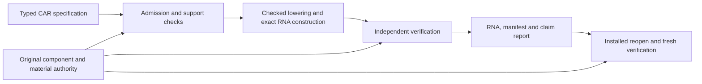

# CAR payload MVP, then therapeutic expansion

Delivery direction approved 2026-10-10: finish one useful therapeutic research
workflow from specification to independently checked RNA output, ship it, then
expand the same compiler outward. The user selected **a CAR payload** as the first
use case. This document supersedes the ordering of the
[four compiler milestones](typed-compiler-next-milestones-2026-10-10.md), while
preserving their work and completion criteria.

This is a delivery plan, not an implementation or acceptance record. The typed
path's validation and merge closeout remains in progress in its owning checkout.
Do not change that frozen candidate or launch another CI run for this roadmap.

## The first product

**A researcher can specify a supported CAR payload for human T cells, construct
its exact complete mRNA specification from qualified supplied material, understand
which requirements are met or unresolved, and independently verify the exported
RNA and manifest outside the repository.**

The immediate practical task is preparing and reviewing a reproducible CAR-RNA
research candidate and its evidence for downstream experimental work. The
intended therapeutic deployment remains human immune cells engineered in vivo.
Human-cell assays and animal studies retain their actual experimental contexts;
they do not change that product target or establish human in-vivo function.

Start with one explicit CAR implementation and one complete RNA architecture.
Select the antigen, indication, exact reference and scoped research claim at C1;
the user's CAR choice has not selected those details. Automated molecular design,
codon optimization, a broad component marketplace, multi-antigen logic and
laboratory automation are not prerequisites for this first release.

The default scope to evaluate at C1 is a CAR receptor-expression payload under
an explicit supplied implementation contract. Exact construction is a narrower
claim than measured surface expression; neither alone establishes antigen-triggered
activity, killing, persistence or delivery. If the chosen research task requires
any of those behaviors, it must carry their implementation and evidence
obligations. Narrowing the task must be an explicit scope decision before
implementation, never a compiler silently dropping an unsupported requirement.

A complete case needs more than an imported CDS or a hardcoded reference export.
Its supported source and configuration choices must constrain the selected
implementation and material. A meaningful edit must change the checked result
or return a specific, correct rejection. The output is the full nominal RNA
specification, including manifest-only features that FASTA cannot express.
Manufacturing, physical batch identity and clinical authorization remain separate.

## Reuse the existing kernel

The implementation already provides substantial scaffolding: typed Python
authoring, admitted semantic representations, component and material contracts,
Core compilation, independent Verify, exact FASTA/manifest export, and a public
research-project workflow. Milestone 1 connects one finite-machine family through
that path; its completion does not make arbitrary CAR biology executable.

Use the existing project, planning, construction and verification interfaces.
Add only the smallest versioned profile needed by the selected CAR case. Do not
create a parallel CAR compiler, a second authority format or a wrapper that
declares success from the producer's own annotations. The older
[intent-candidate profile](intent-candidate-v0.1.md) contains a secretion-oriented
action; it cannot be renamed to mean membrane CAR expression. A real receptor
effect or mechanism gap requires explicit semantics and independent checking.

The claim report keeps source validity, implementation correspondence, complete
material construction, empirical support and use status separately inspectable.
Evidence supports named claims in a stated context; it does not replace semantic
checking. Software acceptance under supplied contracts remains possible when
empirical realization is unresolved, but that result alone cannot satisfy the
real-use-case qualification gate below.

## Phase 1: complete and ship the CAR workflow

These gates define completion order. Independent preparation may overlap, but a
later gate cannot infer an earlier gate's PASS. All new gates are planned/open;
none is completed by writing this document.

| Gate | Deliverable | Exit criterion |
| --- | --- | --- |
| **C0 — Close the typed kernel** | Finish the currently authorized milestone 1 validation, normal merge and fresh actual-main acceptance. | Exact-source development, integration, installed-package and main gates pass with their retained provenance. Preserve the running job and prepared correction; do not reuse acceptance from a superseded revision. |
| **C1 — Freeze the first CAR task** | A short use-case card naming the researcher task, CAR reference/antigen, intended deployment, experimental context, requested behaviors, allowed edits and output contract. | One plausible complete material/evidence source is identified; the source contract and its unsupported obligations are explicit. The case has a useful outcome beyond reproducing a citation or CDS. Decide the smallest feasible scope before adding semantics. |
| **C2 — Qualify its inputs** | One versioned CAR implementation pack with original material, scoped model/contracts, evidence, applicability and independently declared expected material. | Complete RNA identity and the required construct-to-assay correspondence are reconciled; the selected practical claim has suitable supporting evidence. Missing required material or evidence blocks qualification, without blocking independent software work. Distribution terms are recorded for every bundled asset. |
| **C3 — Complete the CAR compiler path** | The minimal CAR-specific semantic, implementation or material extension required by C1, routed through the existing typed kernel. | Every requested requirement is implemented under an explicit contract or rejected. Source, selected mechanism, material placements and emitted bases remain linked through independent checking. No secretion-to-receptor relabeling, inferred mechanism or artificial finite-machine surrogate closes a real mechanism gap. |
| **C4 — Make the workflow usable** | An editable starter, documented public Python and command-line workflow, inspection/diagnostics, and paired export/reverification using the same authority. | A maintainer can create/load the project, make a meaningful supported edit, compile, explain the result, export, and freshly reverify through installed public interfaces without private fixture tools or manual JSON surgery. Record assistance and elapsed time. |
| **C5 — Validate the integrated case** | The real positive case, edit/rejection cases, independent expected outputs and installed acceptance campaign, alongside existing regressions. | All acceptance cases below pass at the exact release candidate; hosted native, cross-platform, installed, integration and fresh actual-main gates are complete. Local/static checks are early feedback, not substitutes. |
| **C6 — Ship the usable MVP** | A versioned installable release with matching compiler/verifier assets, CAR starter or reproducible authorized-input acquisition path, quickstart, support table and evidence report. | Outside-checkout installation and the full documented workflow reproduce the accepted result using complete original inputs. Every unresolved claim remains visible. Release links, source/run/attempt/artifact identities and limitations are published together. |

### C1–C2: qualification is the first new critical path

Continue the existing [reference qualification](researcher-alpha-reference-qualification.md)
and [public evidence review](typed-path-public-evidence-2026-10-10.md). Do not
restart curation already completed or assume a more recent paper closes a missing
material join. Build one compact qualification packet containing:

1. **Original material authority:** exact versioned full transcript, region
   boundaries and joins, encoded product, terminal features, modification and
   chemistry declarations. Keep template DNA, RNA design, physical preparation
   and delivery formulation distinct. A source discrepancy must be resolved,
   not filled with a plausible value.
2. **Implementation authority:** the source behavior supported by that material,
   the selected mechanism/model, observation mapping, provider/resource premises
   and deployment assumptions. Do not derive kinetic or functional contracts
   merely from the nucleotide sequence.
3. **Scoped empirical support:** join the exact construct to the measured
   preparation, cell population/state, environment, endpoint, sampling context,
   analysis and uncertainty. Reproduce the selected observation/analysis where
   the data support it; keep fitted and independently evaluated data distinct.
   Unavailable underlying data limits the claims this packet can qualify.
4. **Independent expectations and access:** expected material and annotations
   derived from original sources independently of compiler output, retained
   provenance, and access/redistribution status for every included asset.
5. **A claim ledger:** construction correctness, model correspondence, empirical
   realization and human-use status, each with its own result and unresolved
   dependencies. Expression evidence cannot discharge functional-response or
   delivery obligations.

The current curated FAP record is CDS-only and retains a murine study context;
the artificial researcher-alpha examples are software controls. Neither is the
qualified human CAR launch case. Two additional primary-source leads illustrate
useful distinctions, without qualifying a component:

| Lead | Useful design constraint | Unresolved qualification work |
| --- | --- | --- |
| [Hunter et al., Science 2025](https://pubmed.ncbi.nlm.nih.gov/40536974/), DOI `10.1126/science.ads8473` | The reported human donor/patient cell experiments and in-vivo humanized-mouse/nonhuman-primate experiments are different applicability contexts. | This bounded review did not verify a complete construct, preparation, underlying data and redistribution correspondence; the abstract does not establish human in-vivo validation. |
| [Gibor et al., 2026](https://pmc.ncbi.nlm.nih.gov/articles/PMC13101584/), DOI `10.1016/j.omtn.2026.102913` | Human T-cell experiments distinguish RNA architecture, expression, antigen-dependent function and tonic signaling. | Indexed primary text describes requested access to raw data/analysis and institutional terms for full maps/sequences. Complete deposited material-to-assay correspondence and reuse terms remain unverified. |

These are a bounded starting shortlist, not the only possible references. If a
candidate lacks essential material or access, choose another CAR reference or
use complete authorized researcher-supplied inputs; do not silently substitute
synthetic values. A by-request source alone is not a reproducible public starter.
A release that requires restricted input must state that requirement and provide
a usable authorized acquisition/import path. Prefer a distributable full example.

Existing suitable measurements may suffice: a new wet-lab campaign is required
only if the selected claim needs evidence that does not already exist. Ordinary
user-supplied contracts still support conditional compilation without empirical
approval. External expert feedback is valuable and tracked separately; waiting
for an external reviewer is not a gate for independently achievable software
delivery. Do not label a maintainer or automated rehearsal an external review.

### C3–C5: the acceptance case drives implementation

Reuse `ResearchProject`, immutable build authority, native planning and the
installed starter/release machinery. Proposed CLI verbs such as project
initialization, inspection, compilation and verification describe the required
workflow, not a claim that a new command family already exists. Use current
public commands where they suffice; add thin interfaces only for demonstrated
usability gaps. A major web UI is optional after the complete workflow works.

Freeze this acceptance matrix with the C1 card before the implementation batch:

| Case | Required result |
| --- | --- |
| Complete reference project | Exact full RNA and manifest match independently declared expectations; supported source-to-component/material correspondence is freshly checked. The report identifies the empirical claim and its actual evidence context. |
| Meaningful supported edit | At least one supported source/configuration edit changes the implementation/material or checking obligation in a predictable, independently checked way. A cosmetic rename does not qualify. If material remains identical, explain why the semantic change is compatible under the supported contract. |
| Unsupported behavior or changed applicability | A concrete source edit, unavailable mechanism, missing delivery premise or incompatible context receives the precise scoped result. The compiler neither silently narrows the source nor treats missing evidence as a negative observation. |
| Corrupted or incomplete input/output | Missing required RNA fields, wrong identities/regions, stale authority, altered chemistry/product or tampered output fail the relevant independent check. Output hashes alone cannot establish authority. |
| Independent reopen | A separate installed invocation rechecks the paired export against complete separately supplied original inputs, without producer execution, fixture generation, implicit downloads or native builds. |
| Usability and release | The documented task succeeds outside the source checkout with matching released assets; errors identify the affected requirement and next actionable correction. Record the manual baseline, elapsed time and maintainer interventions. |

Maintain old profile regressions and explicit bounds. Complete material, exact
translation and useful scientific qualification are separate checks; a generic
PASS must not merge them. If the real case cannot meet C2 or C3, retain that finding
and revise the selected case explicitly. Shipping another engineering fixture
does not finish this MVP.

## Phase 2: expand the shipped kernel through complete use cases

Begin this delivery phase after C6. Every increment must specify its next user
task, identify the smallest missing contract, extend the same compiler and
independent checker, qualify the relevant material/evidence, and ship a complete
installed example while retaining all earlier supported cases.

| Order | Next outcome | Reuse and completion test |
| --- | --- | --- |
| **E1 — A second CAR implementation** | Support another complete CAR design or permitted architecture in the same semantic profile. | Import it through the same versioned interfaces. Reassess its own applicability and evidence; demonstrate that no new per-reference compiler or hidden code path is needed. This tests whether the first case produced reusable infrastructure. |
| **E2 — One richer CAR behavior** | Add the first scientifically supported extra behavior demanded by a named CAR use case, such as conditional expression or a defined effect lifecycle. | State the actual RNA-compatible mechanism and its limits. Distinguish stopping new production, receptor persistence and stopping receptor activity. Existing language vocabulary alone does not complete the behavior. |
| **E3 — Composition for a concrete program** | Combine the necessary modules for a named multi-stage or interacting CAR program, introducing ordering/memory only where needed. | Complete the earlier behavioral-composition milestone: explicit private state, ownership, resources, observations and checked assumptions/guarantees. Compare the first bounded compositional rule with whole-program checking and retain exact material correspondence. |
| **E4 — Quantitative decisions and qualified choice** | Use measured dynamics/uncertainty and multiple qualified implementations to answer a real design question. | Extend the existing quantitative, coupling and approximation machinery only where the case needs it. Recheck each candidate; report bounded tradeoffs, uncertainty and rejection reasons. Distinguish ranked alternatives, search exhaustion and biological infeasibility. This completes the earlier qualified-selection milestone. |
| **E5 — Another therapeutic use case** | Apply the same source-to-RNA chain to another justified human immune-cell therapeutic task. | A new complete use-case pack, minimal semantic extensions and installed release demonstrate reuse. Scientific/lab adapters may then connect exact designs to measurements through versioned interfaces; they do not replace or fork the compiler. |

If a later mechanism is strictly necessary for the first CAR contract, move only
that minimal dependency into C3 and record why. Do not import the whole later
milestone into the MVP. Conversely, do not invent a biologically unsupported
simple implementation to avoid a necessary dependency.

## Relationship to the four earlier milestones

| Earlier milestone | New delivery position |
| --- | --- |
| 1. Typed end-to-end path | Finish the existing C0 closeout; reuse its kernel in C3. Do not restart the migration or claim that its artificial cases qualify the CAR use case. |
| 2. Behavioral composition | E3, unless a narrowly identified part is essential to the C1 contract. General composition is not a prerequisite for a single-component first release. |
| 3. Real component and model-to-policy qualification | Pull its first CAR-specific portion forward into C1–C3, before declaring the practical MVP shipped. Broader qualification continues per expansion. |
| 4. Qualified implementation selection | E4 after real alternatives exist. The MVP may use one supplied compatible implementation; it must still explain eligibility and rejection. |

This orders work by a complete user outcome rather than by maximum vocabulary.
The [product vision](product-vision-and-integration-roadmap.md), existing
[biological evidence plan](biological-correctness-next-phase-handoff.md) and
[researcher-alpha roadmap](researcher-alpha-roadmap.md) remain the detailed
architecture, qualification and delivery references.

## Execution and progress accounting

- **Current implementation checkpoint, 2026-10-11:** the
  [C1 task](car-first-research-task.md) selects the anti-CD19 RM_61461 reference
  for nominal RNA design under supplied expression/localization contracts. The
  [C2 qualification](car-rm61461-qualification.md) reconciles the published RNA,
  encoded product and source-declared chemistry, while keeping the explicitly
  designer-supplied physical end separate. Biological applicability and permitted
  use retain their stated unresolved status. The
  [expression material profile](car-expression-material-profile-design.md),
  [standalone example](../examples/car_payload.py) and
  [quickstart](car-payload-quickstart.md) are implemented source candidates.
  Pure Python, mock and static controls are early feedback. C0 closeout, fresh
  CAR native/installed acceptance, the timed installed usability rehearsal and
  C6 publication remain required; no release is claimed here.
- **Fast feedback:** keep documentation, static/type checks and focused
  pure-Python checks local. Use hosted native validation for coherent batches,
  preserve healthy runs, and retain required integration and fresh-main gates.
  Follow [development validation](development-validation.md). Do not launch CI
  for each curation note or add unrelated CI optimization to the MVP critical path.
- **Isolation:** use an owned separate checkout for roadmap/new work; do not
  update the frozen integration branch until its owning closeout allows it.
  Batch documentation into the next appropriate publication checkpoint.
- **Measure the product:** time from installed starter to verified output,
  unsupported-request diagnostic usefulness, manual interventions, independently
  reproduced material/evidence and reuse on the second case. Test counts and
  number of authoring constructs alone are not delivery measures.
- **Track states separately:** planned, implemented, locally checked,
  hosted-validated, installed, released and empirically qualified. Preserve exact
  source, platform, run, attempt, artifact and merge identities for acceptance.
  Record external review separately. Set implementation estimates after C1–C2
  reveal the actual semantic/material gaps and access dependencies.

The MVP is complete at C6 when the specified CAR research workflow is useful,
integrated, independently checked and shipped. Additional expressivity follows
through complete examples of increasing scope, using this same foundation.
